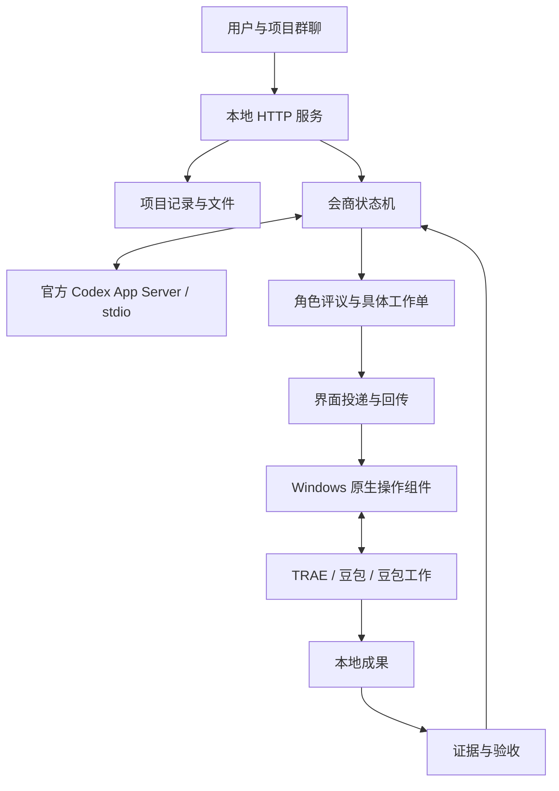

# 架构

src/server.mjs 只监听本机；会话令牌、同源检查与成果预览隔离控制访问。Store 保存项目和审计记录，重启后运行项目保持暂停。

Council 将新目标分为独立轮次。首轮只能建立各成员的职责评议；收到真实回复后，统筹才能生成执行与检验工作单。没有回复或等待用户时不反复推理。

CodexRuntime 使用本机官方 App Server 的公开 stdio 协议。认证由官方 Codex 管理；不复制账户凭据，不回退 API Key。统筹只输出结构化方案，执行交给工作单。

AutomaticExecution 运输统筹编写的提示词，通过原生控件读取回执。草稿只输入一次，发送结果不确定时停止。工作完成标记代表成员声明，实际任务仍需文件和验收证据。

native/ 负责窗口身份检查、控件观察、后台截图、有限后台输入以及用户主动进入/返回独立桌面。没有通用物理鼠标键盘兜底。独立桌面与主桌面属于同一用户，不构成文件权限隔离。

可选 skills/coordinate-project 和 MCP 支持手动宿主统筹。手动与自动统筹不可同时驱动同一项目。
